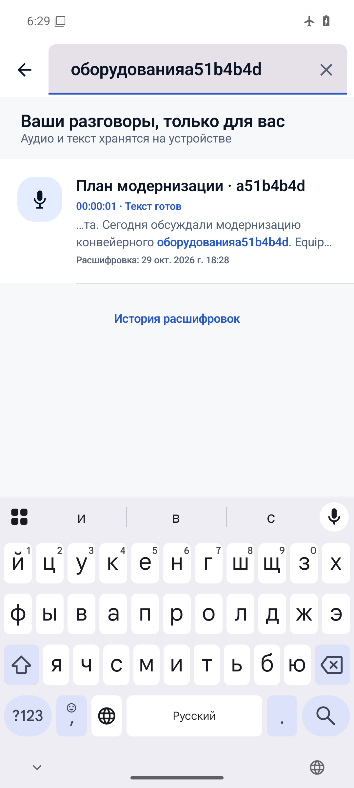
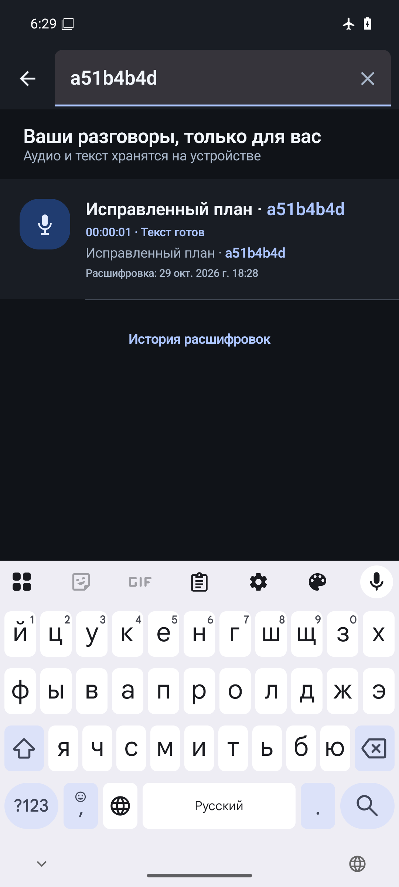
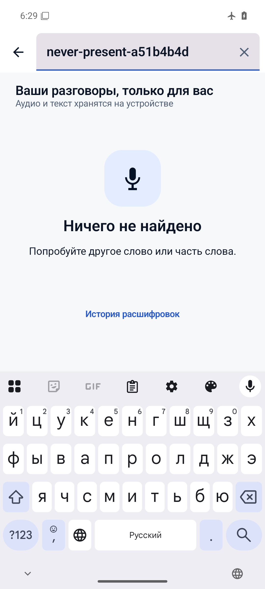

# DORA — Stage 10.3C: Search & recording library

29 октября 2026. **PASS / STAGE10_SEARCH_ALPHA_READY** — программная Alpha-готовность.
**DEVICE_VALIDATION_PENDING** — новая APK на POCO не устанавливалась.

Ветка `codex/stage10-signal-ui`, [Draft PR #123](https://github.com/Monumentogram/DORA/pull/123).
Перед работой remote HEAD проверен: `c20b6ce0d15174f4ad1fb8e78f5cfac834e823b7`,
OPEN / DRAFT / UNMERGED. Изменения продолжают эту ветку; main и история не переписаны,
merge не выполнялся. Git SHA итоговой публикации указан в сообщении сдачи задачи.

## Реализация

- На главной Signal UI: поиск, автоматический фокус/клавиатура, очистка, закрытие,
  обновление при вводе, отдельное состояние отсутствия совпадений и повтор при ошибке.
- Поиск по отображаемому названию и всему активному тексту с последними пользовательскими
  правками. Неактивные машинные версии и исторические правки в выдачу не попадают.
- RU/EN, Unicode, регистронезависимое буквальное совпадение части слова, обрезка пробелов
  по краям. `%`, `_`, скобки и `*` не интерпретируются как SQL/FTS/regex-операторы.
- Существующие карточки: название, длительность, состояние аудио/текста, дата с подписью
  «Расшифровка», фрагмент около совпадения и синий акцент. Без транскрипции доступен
  поиск по существующему названию с коротким ID; явно показано отсутствие расшифровки.
- Результат открывает прежний редактор/плеер. После закрытия редактора выдача читается
  заново. При фоне запрос и результаты очищаются; история версий сохраняется.
- Существующий SQLCipher, keyset paging и правила доступа. Нет новой базы, миграции,
  незашифрованного индекса или сохранённого поискового кэша. Поиск не обращается в сеть,
  telemetry или текстовые логи. Полные документы не передаются на UI-поток.
- Debounce 200 мс, generation guard и отмена между записями/внутри длинного текста.
  Линейное Unicode-сравнение исключает задержку на повторяющихся длинных префиксах.

Архитектура и ограничения: [ADR-SIGNAL-003](adr/ADR-SIGNAL-003-local-recording-search.md).
Product FTS отсутствует; отдельный PoC имеет другую схему и prefix-token контракт.

## Проверки

| Проверка | Результат |
|---|---|
| App OwnerPreview unit | 118 / 118 PASS |
| Core audio release unit | 274 / 274 PASS, в том числе 7 новых поисковых тестов |
| Core model unit | 5 / 5 PASS |
| Host no-application-PIN regression | 3 / 3 PASS |
| Финальный применимый UI-набор | 5 / 5 PASS, Android emulator x86_64 API 36 |
| Реальный SQLCipher: актуальность, reopen, deletion и 10/100/1000 | 2 / 2 PASS |
| Полный перезапуск процесса и повторный поиск правки | PASS после force-stop / fresh launch |
| Offline | PASS, `airplane_mode_on=1` во время UI и restart-проверок |
| `spotlessCheck`, `detekt` | PASS |
| `:app:lintOwnerPreview` | 0 errors, 18 warnings, 4 hints |
| Подписанная OwnerPreview APK и аудит | PASS |

UI-набор включает поиск, быстрый ввод, очистку/закрытие, пустую выдачу, сохранение правки,
исчезновение старого текста, recreate, отсутствие транскрипции, светлую/тёмную темы,
плеер/seek/busy/background, навигацию и pause/resume/save записи. Только синтетические данные.

| Требование из задания | Доказательство |
|---|---|
| 1–6: название, весь текст, регистр, часть слова, RU/EN | RecordingSearchTest + UI + encrypted persistence |
| 7: исправления | Реальный редактор → сохранение → новый поиск; старый текст отсутствует |
| 8: активная версия | Реальный transcript select; история сохранена, выдача заменена |
| 9: удаление | Изолированная синтетическая запись; tombstone исключает результат после reopen |
| 10–11: пустой запрос / нет совпадений | Core и UI; обычная библиотека / понятное пустое состояние |
| 12–13: перезапуск / без интернета | Отдельный fresh-process UI readback в авиарежиме |
| 14: длинный текст | Полный поиск за пределами карточки, длинный fixture в библиотеке 1000 |
| 15: быстрое изменение запроса | UI + отмена сканирования + отмена внутри длинного near-match |

### История попыток, не заменяющая финальные результаты

Исходные red-тесты отсутствующей реализации и исправления ревью сохранены локально.
Первая incremental Kotlin-сборка не нашла существующие top-level функции; полная
компиляция с `-Pkotlin.incremental=false` прошла без изменения этих функций.
Начальные замечания detekt исправлены. Первая UI-проверка очистки учитывала placeholder
как введённый текст; теперь проверяет именно `EditableText`. Под нагрузкой fixture
закрывал редактор до окончания async save; добавлено ожидание сохранённых правок.
Финальный прогон 5/5 прошёл после этих исправлений.

В более широком промежуточном прогоне старый `TranscriptUiTest` прошёл редактирование
и повторное открытие, затем завершился таймаутом на строке 113 — ожидании сообщения
об отсутствующем ASR-пакете после «Распознать заново». Этот FAIL не переписан в PASS;
сценарий отсутствующей модели не входит в финальный поисковый набор. Модель не удалялась,
ASR не изменялся и причина этого ожидания здесь не расследовалась. Регрессия редактора
проверена новым сквозным тестом, плеера — прежним SignalAcceptanceTest.
Stage 10.5C остаётся закрытым в объёме владельца: `ROOT_CAUSE_NOT_PROVEN`.

## Производительность

Реальный зашифрованный storage, синтетический PCM/текст; три замера каждого случая.
Время выполнения на worker включает существующий recovery для совпавшего аудио,
не включает создание fixtures, первичное открытие vault и debounce 200 мс.
Это эмуляторные наблюдения, не POCO и не промышленный latency gate.

| Записей | Нет совпадений, медиана | Первая страница, медиана | Совпадение в конце последней записи, медиана |
|---:|---:|---:|---:|
| 10 | 52 мс | 1158 мс | 143 мс |
| 100 | 357 мс | 1775 мс | 441 мс |
| 1000 | 4005 мс | 1951 мс | 3799 мс |

Максимум полного no-match scan на 1000: **5900 мс**. Это заметное ожидание результата,
а не мгновенный поиск; UI получает loading state, отмена остаётся доступна.
Тяжёлая работа выполняется вне UI. Отдельный frame-time gate не вводился.
Тест с генерацией всех данных занял 820 с; это не время поиска.
Обычные тексты — 100 повторов предложения, последний длинный — 2000, в пределах
существующего лимита 262144 UTF-8 bytes. Нет тестов на миллионах записей.
[Все замеры](evidence/stage103c/performance.csv), [verification receipt](evidence/stage103c/verification.json).

## APK и сохранность

Owner-local APK: `outputs/stage103c/dora-search-owner-preview-vc5.apk`, 84 055 621 байт.

- SHA-256: `81b1d1ee2454545706b59c40ad2278368c3d21288e7cc49fc486ab328a423e79`.
- Package: `com.monumentogram.dora.alpha.preview`, versionCode `5`, versionName
  `0.1.0-owner-preview.5`.
- Certificate SHA-256: `a5f865ce5d28056429b323ede48f53e9ae8ad06880ea20ed242c2a2ba274603d`.
- Подпись прежняя; manifest/native/runtime assets побайтно совпадают с Stage10 Preview5
  `d4408fa8…`. Проверено выравнивание 16 KB; Whisper-модель в APK не включена.
- [Signing receipt](evidence/stage103c/apk-verification.json) сравнивает также исходную
  unified Preview; [отдельное сравнение с точной Stage10 APK](evidence/stage103c/stage10-baseline-comparison.json).
- Preview v5 user 10, исторические user 0/user 10, Pilot v2 и физический POCO не изменялись.
  `pm clear`, uninstall, сброс ключей и удаление пользовательских записей не выполнялись.
  Удаление в тесте относится исключительно к его изолированной синтетической записи.
- Cloud backend, постоянная регистрация, Keystore и Whisper Small q8_0 не изменены.

## Скриншоты и ревью

Синтетический эмулятор; FLAG_SECURE снимается только instrumentation fixture для снимка.
В продуктовой APK защита сохранена.

[Независимое ревью](evidence/stage103c/independent-review.md): Critical не найдено;
Important по отмене длинного запроса исправлен и проверен red→green. Уточнена граница
памяти: один документ/20 проекций на scan, UI сохраняет ранее загруженные страницы.
Новых известных P0/P1 после исправлений не осталось. Это не разрешение на merge.

## Остаточные ограничения и следующий этап

Физическая приёмка POCO — `DEVICE_VALIDATION_PENDING`; установка поверх Preview v5
требует отдельного разрешения. На 1000 записях полный scan занимает несколько секунд.
Нет persistent FTS, fuzzy/semantic search, новых пользовательских названий, настоящей
даты записи или перехода по слову в аудио. Существующие storage/recovery операции
неделимы; отмена проверяется между ними и внутри сравнения текста.

Рекомендация: **переходить к Stage 11: приватность, offline и экспорт**. Продуктовая
часть поиска Stage 10 готова в Alpha-объёме. Приёмку новой APK на POCO вести отдельно;
не возвращаться к закрытому Stage 10.5C и не трактовать этот PASS как оценку качества ASR.
Published CI, если запускается на этой ветке, указывается отдельно от локального PASS.

## Дополнение: публикация и CI

Реализация опубликована commit `e2ac6a89e30c60e406837f53160b02438555a365` в Draft PR #123.
Первый удалённый `software` run [40933055095](https://github.com/Monumentogram/DORA/actions/runs/40933055095)
завершился FAIL до сборки: `ARM82_INVENTORY_NOT_EXHAUSTIVE_OR_DISJOINT`.
Два новых метода RecordingSearchPersistenceTest отсутствовали в обязательном реестре.
В продолжении добавлены только эти два метода; ожидаемое число тестов увеличено 162 → 164.
Исторические исключения и результаты не менялись. Host-проверка реестра: 7/7 PASS.
Эта поправка касается учёта тестов и документации, байты подписанной APK не меняются.
